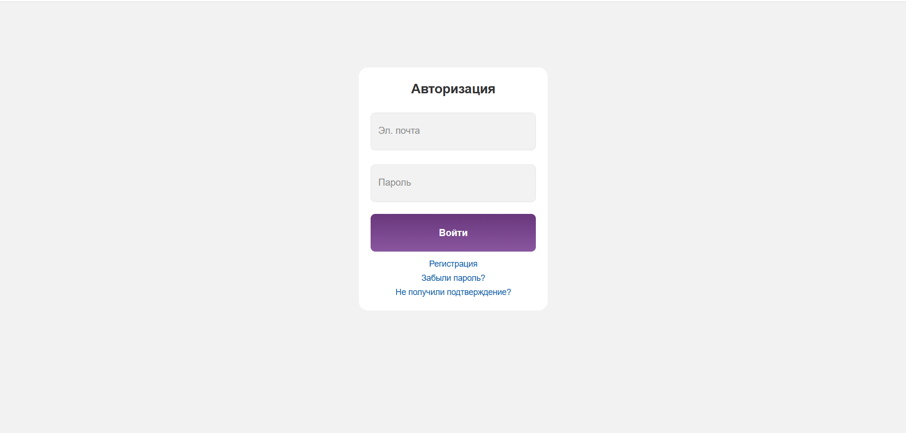
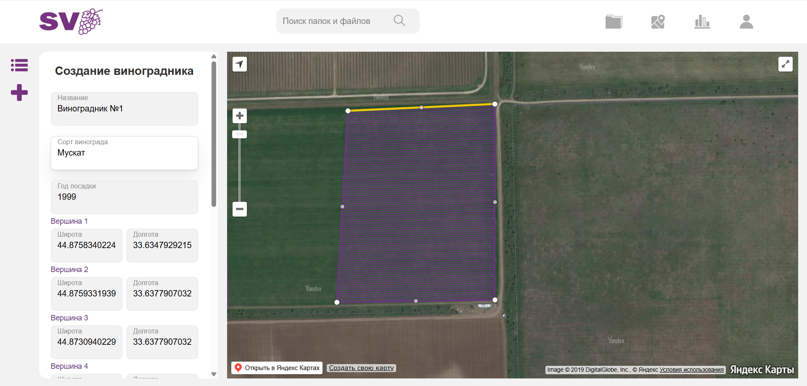
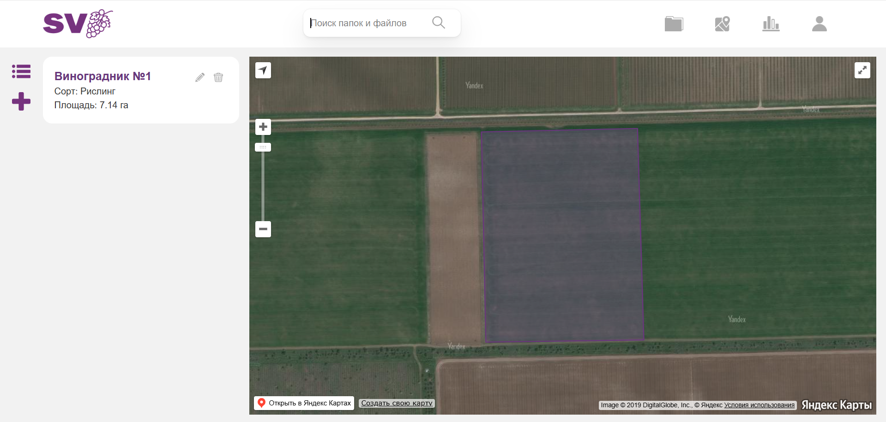
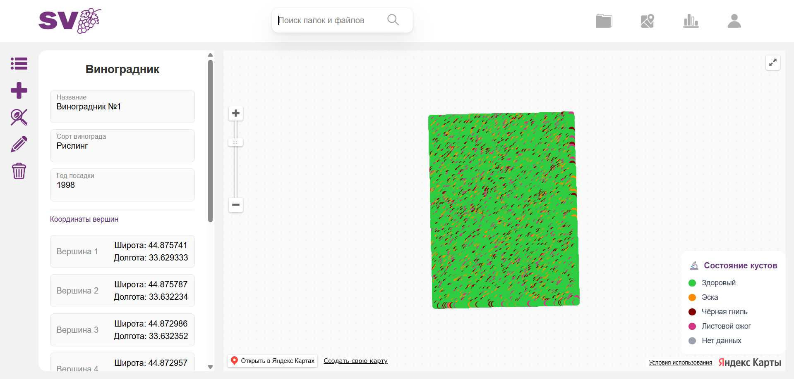
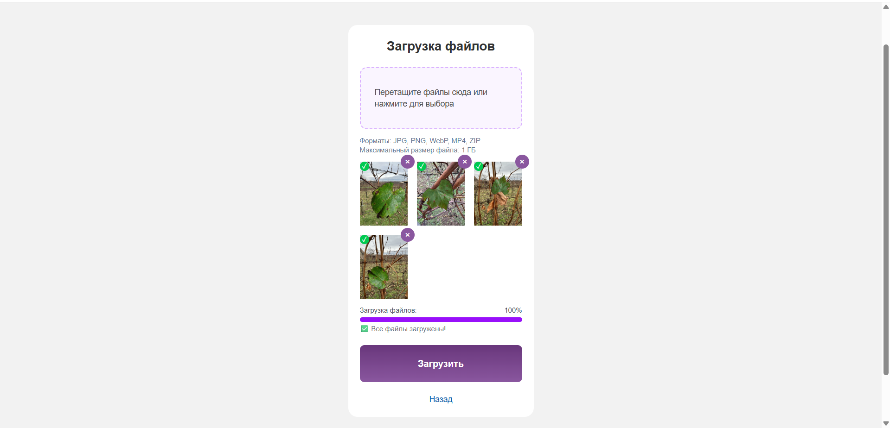
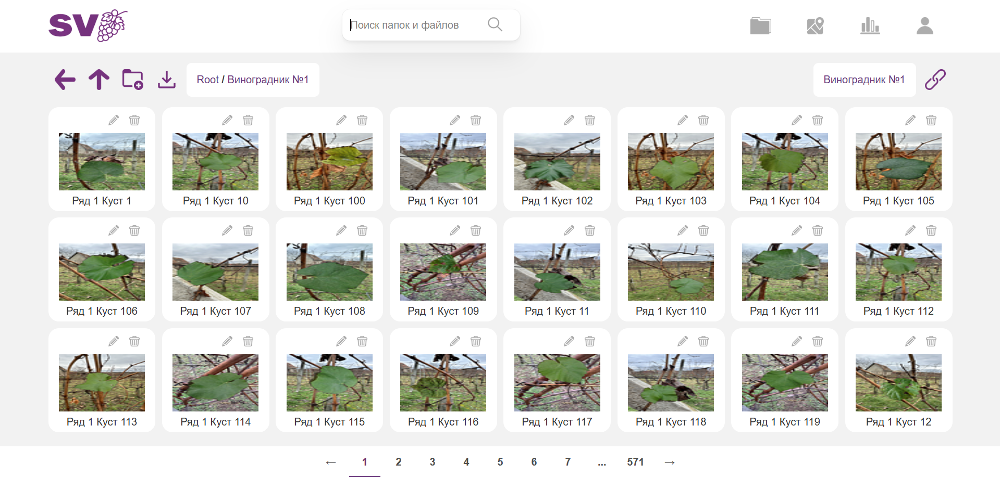
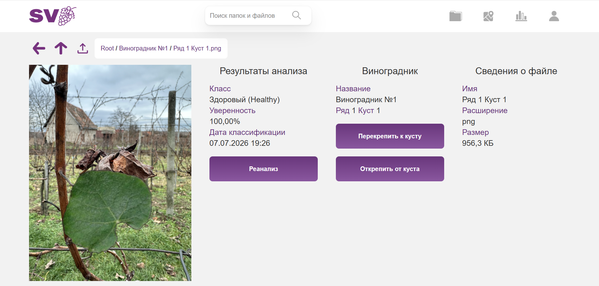
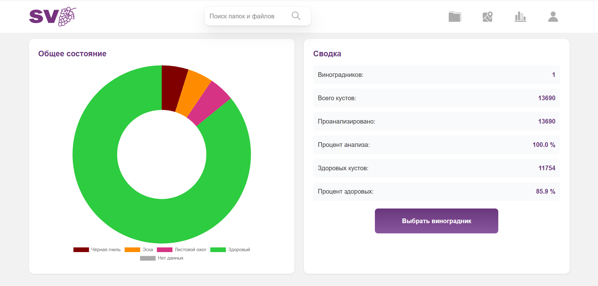

# Smart Vineyard

A web application for vineyard management with AI-based vine health classification.

## Screenshots

| Login | Create Vineyard |
|-------|----------------|
|  |  |

| Vineyard Map | Health Heatmap |
|-------------|---------------|
|  |  |

| File Upload | Media Explorer |
|------------|---------------|
|  |  |

| Classification Result | Statistics |
|----------------------|------------|
|  |  |

## Features

- **Vineyard map** — draw and edit vineyard polygons on an interactive map (Yandex Maps)
- **Row and bush structure** — rows and bushes are generated from the polygon, row spacing and bush spacing; editing the geometry updates them in place
- **Media library** — upload photos, videos and ZIP archives, organize them into nested folders, link a folder to a vineyard and a file to a bush (automatically by file name `Ряд N Куст M`)
- **AI classification** — vine health from a photo (black rot, ESCA, leaf blight, healthy) with a local ONNX model
- **Statistics** — disease breakdown charts and a per-bush health heatmap
- **Demo mode** — a "Demo account" button on the login page clones a master account into a temporary user that is deleted after 24 hours

## Stack

- **Ruby on Rails 8.1**, Ruby 3.3.12, PostgreSQL 16 + PostGIS
- **Devise** — authentication (with email confirmation), **Pundit** — authorization
- **Solid Queue** — background jobs, **Solid Cable** — Action Cable over PostgreSQL (no Redis)
- **ActiveStorage** — media storage on local disk (a persistent volume in production)
- **ONNX Runtime** + **libvips** — AI inference and image processing, **FFmpeg** — video previews
- **Hotwire** (Turbo + Stimulus), importmap, TailwindCSS 4, Chart.js
- Deployment: Docker image (arm64) + Helm chart on k3s, GitHub Actions CI/CD

## Requirements

- Ruby 3.3.12 (`.ruby-version`)
- PostgreSQL with the PostGIS extension
- libvips and FFmpeg

## Configuration

### Development: `.env`

Settings are read from environment variables; in development they are loaded from `.env` in the project root by `dotenv-rails` (the file is git-ignored):

```dotenv
# Database (database names are fixed in config/database.yml)
DB_USER=
DB_PASSWORD=
DB_HOST=localhost
DB_PORT=5432

# Yandex Maps JavaScript API key — required for the map
YANDEX_MAPS_API_KEY=

# SMTP for Devise emails (Yandex by default)
SMTP_USER_NAME=
SMTP_PASSWORD=

# Optional: email of the account cloned into demo users; the demo button is hidden if empty
DEMO_MASTER_EMAIL=
```

### Production: Kubernetes secret

The Helm chart reads secrets from `smart-vineyard-secrets` in the `smart-vineyard` namespace (`chart/templates/_helpers.tpl`):

| Secret key            | Env variable          | Required | Notes                                   |
|-----------------------|-----------------------|----------|-----------------------------------------|
| `db-name`             | `DB_NAME`             | yes      | also used by the Postgres StatefulSet   |
| `db-user`             | `DB_USER`             | yes      |                                         |
| `db-password`         | `DB_PASSWORD`         | yes      |                                         |
| `secret-key-base`     | `SECRET_KEY_BASE`     | yes      |                                         |
| `smtp-user-name`      | `SMTP_USER_NAME`      | yes      |                                         |
| `smtp-password`       | `SMTP_PASSWORD`       | yes      |                                         |
| `smtp-address`        | `SMTP_ADDRESS`        | no       | default `smtp.yandex.ru`                |
| `smtp-port`           | `SMTP_PORT`           | no       | default `465`                           |
| `smtp-domain`         | `SMTP_DOMAIN`         | no       | default `yandex.ru`                     |
| `mailer-sender`       | `MAILER_SENDER`       | no       | "From" address of Devise emails         |
| `yandex-maps-api-key` | `YANDEX_MAPS_API_KEY` | no       | the map does not load without it        |
| `demo-master-email`   | `DEMO_MASTER_EMAIL`   | no       | enables demo mode                       |

Add or change a key, then restart the pods (env from a secret is read only at startup):

```bash
kubectl -n smart-vineyard patch secret smart-vineyard-secrets \
  --type merge -p '{"stringData":{"demo-master-email":"master@example.com"}}'
kubectl -n smart-vineyard rollout restart deploy
```

Non-secret settings (host, threads, DB pool, log level, resources, volume sizes) live in `chart/values.yaml`.

## Setup

```bash
git clone <repo>
cd smart_vineyard
# create .env (see above)
bin/setup     # bundle install + db:prepare (primary, queue and cable databases) + starts bin/dev
```

`bin/dev` runs the web server, the Tailwind watcher and the Solid Queue worker (`Procfile.dev`). Use `bin/rails db:prepare` rather than `db:create db:migrate`: it also loads the `queue` and `cable` database schemas.

## Tests

```bash
bundle exec rspec
```

RSpec + FactoryBot + Shoulda Matchers + Faker, 207 examples:

- `spec/models/` — validations, associations and model methods, including database-level uniqueness (one file per bush, one folder per vineyard)
- `spec/jobs/` — every background job: row/bush generation and regeneration, ZIP processing, bush distribution, previews, classification, demo cloning and cleanup, storage cleanup and its schedule
- `spec/services/` — `DemoCloneService`, `GrapeClassifier` (runs the real ONNX model)
- `spec/requests/` — HTTP flows with authentication and authorization: vineyards, folders, media items, rows, registrations, demo sessions (incl. rate limiting), ActiveStorage overrides, `/up`

CI (`.github/workflows/ci.yml`) also runs Brakeman, `importmap audit` and RuboCop.

## Background Jobs

Solid Queue runs as a separate process (`bin/jobs`; the `worker` deployment in production). Queues, in the order workers take them:

- `default` — uploads and ZIP processing, image/video previews, filename normalization, distribution to bushes, row/bush generation, demo cloning, and classification started manually with the "Анализ" button
- `low_priority` — bulk classification of uploaded photos, storage cleanup

Previews go first so thumbnails appear right after an upload; bulk classification catches up after them.

The work is CPU-bound (libvips, ONNX Runtime), and threads of one Ruby process don't run it in parallel (GVL), so parallelism comes from processes: `worker.concurrency` (`JOB_CONCURRENCY`, 3 by default for a 4-core node) with `worker.threads` (`JOB_THREADS`, 5) each, in `chart/values.yaml`.

Recurring tasks (`config/recurring.yml`, production only):

- `cleanup_orphaned_storage` — daily at 3:00, removes unattached blobs and attachments of deleted records (shared demo blobs and pending ZIP uploads are kept)
- `clear_solid_queue_finished_jobs` — hourly

## Demo Mode

When `DEMO_MASTER_EMAIL` is set and points to an existing user, the login page shows a "Demo account" button (`POST /demo_session`):

1. `DemoCloneService` creates a temporary confirmed user and copies the master's active vineyards, rows, bushes and folders.
2. `CloneDemoMediaJob` copies media items; they share the master's files (no file copies). Renaming a file in the demo first gives it its own copy, so the master is never changed.
3. `CleanupDemoUserJob` deletes the demo user after 24 hours; shared files stay with the master.

Demo creation is rate limited: 10 per hour per IP and 100 per hour overall.

## Deployment

Pushing to `main` runs CI; when it passes, `.github/workflows/deploy.yml`:

1. checks that the commit is newer than the one in production (an older CI run finishing late never rolls production back);
2. builds an arm64 image and pushes `ghcr.io/gorgomania/smart_vineyard:<sha>`;
3. copies `chart/` to the server and runs `helm upgrade --install smart-vineyard ... --set image.tag=<sha>`;
4. tags the deployed image as `latest`.

Deploys run one at a time. A manual run is available via "Run workflow" (`workflow_dispatch`). Migrations run on pod start (`bin/docker-entrypoint` → `db:prepare`).

Required repository secrets: `SSH_HOST`, `SSH_KEY`.

## AI Classification

> Training, conversion, and testing scripts, dataset info, and trained models: **[grape_disease_classifier](https://github.com/gorgomania/grape_disease_classifier)**

The model (`grape_model.onnx`) is based on the **EfficientNet-B0** architecture, trained on a grape leaf disease dataset. Runs locally via ONNX Runtime with no external API calls.

**Image preprocessing:**
- Resize preserving aspect ratio and center-crop to 224×224
- ImageNet normalization (mean `[0.485, 0.456, 0.406]`, std `[0.229, 0.224, 0.225]`)
- Input tensor: `[1, 3, 224, 224]` (NCHW)

**Classes:**

| ID | Name                  |
|----|-----------------------|
| 0  | Black Rot             |
| 1  | ESCA                  |
| 2  | Healthy               |
| 3  | Leaf Blight           |

For each image the model returns the predicted class, confidence score, and per-class probabilities.

**Metrics on the test set (3,610 images):**

| Class        | Precision  | Recall     | F1-score   | Images    |
|--------------|------------|------------|------------|-----------|
| Black Rot    | 99.68%     | 99.58%     | 99.63%     | 944       |
| ESCA         | 99.69%     | 99.79%     | 99.74%     | 960       |
| Healthy      | 99.65%     | 99.76%     | 99.70%     | 846       |
| Leaf Blight  | 99.77%     | 99.65%     | 99.71%     | 860       |
| **Total**    | **99.70%** | **99.70%** | **99.70%** | **3,610** |

## Data Structure

```
User
├── Vineyard (soft delete via deleted_at)
│   └── Row
│       └── Bush
└── Folder (nested via parent_id)
    └── MediaItem (photo/video, preview, AI classification)
```

Links between the two trees (both optional and unique):

- `Folder.vineyard_id` — at most one folder per vineyard; files in it are distributed to the vineyard's bushes by name
- `MediaItem.bush_id` — at most one file per bush
